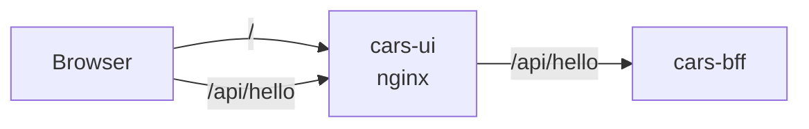

<!--
@license
Copyright (c) rljson

Use of this source code is governed by terms that can be
found in the LICENSE file in the root of this package.
-->

# The first page: hello in the browser

## Motivation

- The cars example app runs in the browser; this repo is the front end
  that runs on the server as static files
- Before any real page exists, the repo has to prove that it can be
  built, tested, packed into a container and that it reaches the backend
- So its first release is one page that shows hello lines

## Strategy

- Set the repo up the way every rljson repo is set up: the rljson DNA
  for guides and skills, the TypeScript toolchain for build and tests
- Run as an app of its own, the container `cars-ui`, served by nginx
- Reach the backend for frontend over HTTP only: nginx forwards `/api`
  to it, so the page and the API share one host
- Keep the package private (`"private": true`), never on npm

## Implementation: the setup

- `gg dna init` and `gg dna add @rljson/dna-rljson` brought the guides,
  the skills for Claude and the GitHub checks
- vite builds the package, vitest tests it with 100 % coverage, eslint
  checks the code and its JSDoc
- `index.jsonc` names `cars-bff-runtime` in `interfaces.uses`

## Implementation: the page

- `public/index.html` loads `cars-ui-runtime.js` and calls `showHello()`
- `helloLines()` returns `Hello from cars-ui-runtime`, then the lines of
  `GET /api/hello`
- Without an answer it shows `(no answer from /api/hello yet)`, so the
  page works before the backend runs
- The fetch function is passed in, so the tests need no server

## Implementation: the container

- The Dockerfile builds the package on `node:22-alpine` and copies the
  page and the script into `nginxinc/nginx-unprivileged`
- nginx listens on 8080, answers `/healthz` and forwards `/api/` to
  `BFF_URL`, by default `cars-bff` in the namespace `demo`
- nginx resolves the backend at request time, so the page starts without
  it
- The container runs as uid 1000; `az acr build` builds it in the
  registry, tag `<version>-<sha>`

## Result

- The page shows its own line and every line the backend answers

## Open Points

- The real front end on `@rljson/uikit` replaces the page later
