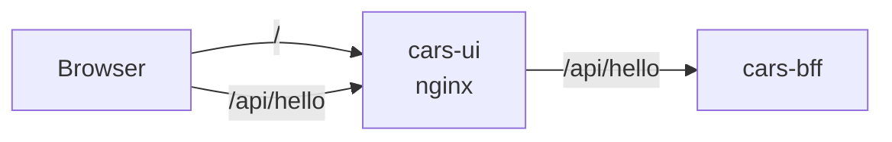

<!--
@license
Copyright (c) rljson

Use of this source code is governed by terms that can be
found in the LICENSE file in the root of this package.
-->

# Die erste Seite: Hello im Browser

## Motivation

- Die cars-Beispiel-App läuft im Browser; dieses Repo ist das Frontend,
  das auf dem Server als statische Dateien liegt
- Bevor es eine echte Seite gibt, muss das Repo zeigen, dass es sich
  bauen, testen und in einen Container packen lässt und das Backend
  erreicht
- Sein erstes Release ist deshalb eine Seite, die Hello-Zeilen zeigt

## Strategie

- Das Repo so aufsetzen wie jedes rljson-Repo: die rljson-DNA für
  Anleitungen und Skills, die TypeScript-Toolchain für Build und Tests
- Als eigene App laufen, der Container `cars-ui`, ausgeliefert von nginx
- Das Backend for Frontend nur über HTTP erreichen: nginx leitet `/api`
  weiter, sodass Seite und API einen Host teilen
- Das Paket privat halten (`"private": true`), nie auf npm

## Umsetzung: der Aufbau

- `gg dna init` und `gg dna add @rljson/dna-rljson` brachten die
  Anleitungen, die Skills für Claude und die GitHub-Prüfungen
- vite baut das Paket, vitest testet es mit 100 % Abdeckung, eslint
  prüft den Code und sein JSDoc
- `index.jsonc` nennt `cars-bff-runtime` in `interfaces.uses`

## Umsetzung: die Seite

- `public/index.html` lädt `cars-ui-runtime.js` und ruft `showHello()` auf
- `helloLines()` liefert `Hello from cars-ui-runtime`, dann die Zeilen von
  `GET /api/hello`
- Ohne Antwort zeigt sie `(no answer from /api/hello yet)`, damit die
  Seite schon vor dem Backend funktioniert
- Die Fetch-Funktion wird übergeben, sodass die Tests keinen Server
  brauchen

## Umsetzung: der Container

- Das Dockerfile baut das Paket auf `node:22-alpine` und kopiert Seite
  und Skript in `nginxinc/nginx-unprivileged`
- nginx hört auf 8080, beantwortet `/healthz` und leitet `/api/` an
  `BFF_URL` weiter, standardmäßig `cars-bff` im Namespace `demo`
- nginx löst das Backend erst bei der Anfrage auf, sodass die Seite ohne
  es startet
- Der Container läuft als uid 1000; `az acr build` baut ihn in der
  Registry, Tag `<version>-<sha>`

## Ergebnis

- Die Seite zeigt ihre eigene Zeile und jede Zeile, die das Backend
  antwortet

## Offene Punkte

- Das echte Frontend auf `@rljson/uikit` ersetzt die Seite später
